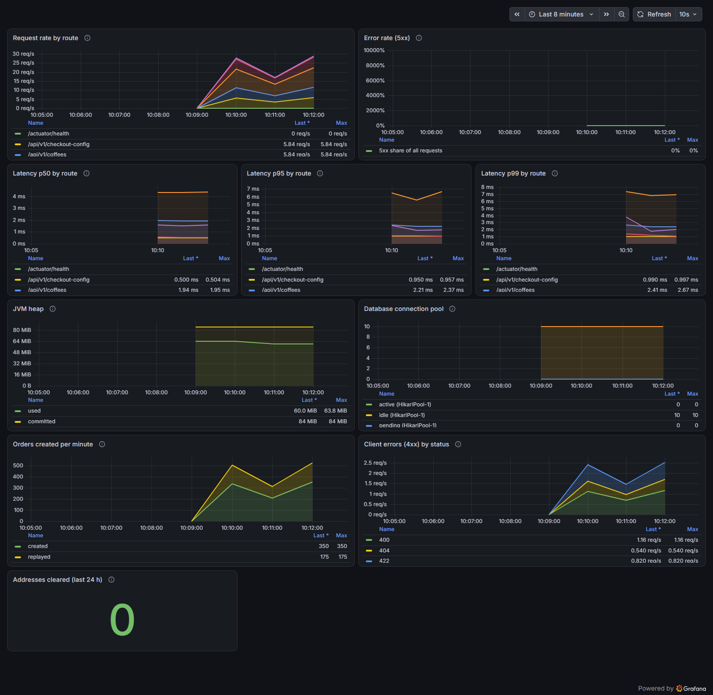

# Observability

How the API is observed, what each signal answers, how the code and the dashboard are kept in step, and the evidence from a real run. Everything here was measured on 2026-11-13 against the code of commit `98260bd` plus the business metrics added in the same round ([ADR](../adrs/testing-and-observability-evidence.md)).

## 1. The principle

Observability is part of every endpoint from the first one, not added later (rule in [DEVELOPMENT.md](../.docs/DEVELOPMENT.md)). Three signals leave the API without a line of code in a use case, and one more is written on purpose:

| Signal | What | How it leaves the API | Where to look |
| --- | --- | --- | --- |
| Logs | One JSON line per request, plus a line per job run | Standard output (`logstash` JSON format of Spring Boot) | The console of the API; correlate by `traceId` |
| Metrics | HTTP latency histogram, JVM, database pool, and three business counters | Micrometer, pushed every 10 s by OTLP to the collector (port 4318) | Prometheus inside Grafana LGTM, and the dashboard |
| Traces | One span per HTTP request, sampled at 100% | OTLP to the collector (port 4318) | Tempo inside Grafana LGTM |
| Business counters | `orders.created{outcome}`, `orders.addresses.cleared`, and the HTTP status counts | Same path as metrics | Panels 8 to 10 of the dashboard |

The local stack is `yarn infra:up` (Grafana LGTM: Loki, Grafana, Tempo, Prometheus and the OpenTelemetry collector in one image, pinned in `compose.yaml`) and Grafana is at <http://localhost:3030>. The API gets its collector address from `OTEL_EXPORTER_OTLP_ENDPOINT` (default `http://localhost:4318`); `ApplicationConfigTest` pins that the address comes from the environment.

## 2. Logs

- `RequestLoggingFilter` runs inside the observation filter, so every line carries `traceId` and `spanId`, and writes `request completed` with `method`, `path`, `status`, and `durationMs`. The query string is never logged (it may carry what a person typed).
- `ClearOldAddressesJob` logs one line per run with the count and the number of days. It never logs address data: the line has only the count and the days.
- Real line of this run (a `POST /api/v1/orders` that answered `201`):

```json
{"@timestamp":"2026-11-13T10:13:49.2834502-03:00","message":"request completed","logger_name":"com.coffeedelivery.shared.logging.RequestLoggingFilter","level":"INFO","traceId":"70b7b9c85233bb6d8c76942f50b7a358","spanId":"2e6f914a7c21a2b9","method":"POST","path":"/api/v1/orders","status":201,"durationMs":4}
```

## 3. Traces

Spring Boot 4 creates one server span per request and exports it. Taking the `traceId` of the log line above and asking Tempo through Grafana returned the span:

```text
GET /api/datasources/proxy/uid/tempo/api/traces/70b7b9c85233bb6d8c76942f50b7a358
1 spans
 - http post /api/v1/orders 5.17 ms
```

The log says 4 ms (it measures inside the filter) and the span says 5.17 ms (it includes the servlet container): the two agree. **Known limit:** there is no span for the JDBC calls (no JDBC instrumentation is added), so the trace tells that a request was slow, not which statement. For statements, the project counts them in tests instead (`StatementCounter`, spec 034).

## 4. Metrics

The names were read from the running Prometheus, not guessed ([ADR of spec 008](../adrs/api-observability-and-load-tests.md)):

| Metric | Labels | Source |
| --- | --- | --- |
| `http_server_requests_milliseconds_{count,sum,bucket}` | `uri` (route template), `method`, `status`, `outcome` | Spring MVC. Percentiles need `management.metrics.distribution.percentiles-histogram[http.server.requests]: true`, pinned by `ApplicationConfigTest` |
| `jvm_memory_used_bytes`, `jvm_memory_committed_bytes` | `area` | JVM |
| `hikaricp_connections_{active,idle,pending,max}` | `pool` | HikariCP |
| `orders_created_total` | `outcome=created\|replayed` | `CreateOrderRequestHandler`: a new order, or an `Idempotency-Key` repeat that created nothing (spec 032) |
| `orders_addresses_cleared_total` | none | `ClearOldAddressesJob` (spec 038) |

Checked live in this round: `orders_created_total{outcome="created"}` and `{outcome="replayed"}` and `orders_addresses_cleared_total` all exist in Prometheus after the first traffic, because the counters are registered when the beans are built, so `increase()` works from the first request.

## 5. The dashboard

`Coffee Delivery API` (`infra/grafana/dashboards/coffee-delivery-api.json`, uid `coffee-delivery-api`) is provisioned from files: it appears with `yarn infra:up`, it is not editable in the UI (`allowUiUpdates: false`), and a test reads the JSON. Ten panels, each tied to a question:

| # | Panel | Question it answers | Query (shortened) |
| --- | --- | --- | --- |
| 1 | Request rate by route | Which routes get the traffic? | `sum by (uri) (rate(http_server_requests_milliseconds_count[1m]))` |
| 2 | Error rate (5xx) | Is the API failing? | 5xx rate divided by all requests |
| 3 to 5 | Latency p50, p95, p99 by route | Which route is slow, and is it the tail? | `histogram_quantile(q, sum by (le, uri) (rate(..._bucket[1m])))` |
| 6 | JVM heap | Is memory growing? | `jvm_memory_used_bytes{area="heap"}` and committed |
| 7 | Database connection pool | Is the pool the bottleneck? | `hikaricp_connections_*` |
| 8 | Orders created per minute | How much business is the API doing, and how many requests were retries? | `sum by (outcome) (increase(orders_created_total[1m]))` |
| 9 | Client errors (4xx) by status | Who sends bad requests: invalid bodies (400), unknown routes or orders (404), content the server refuses (422)? | `sum by (status) (rate(...{status=~"4.."}[1m]))` |
| 10 | Addresses cleared (last 24 h) | Did the retention job run and clear? | `sum(increase(orders_addresses_cleared_total[24h])) or vector(0)` |

Because panels group by `uri`, a new endpoint appears without editing the dashboard (the quote endpoint appeared by itself). A new kind of event, such as an order or a cleared address, needs a counter and a panel in the same change.

### Evidence: the dashboard under a mixed load



Traffic of this capture (`node traffic.mjs`, about 5 requests per second for 4 minutes against the API built from the current code, one client): orders with an `Idempotency-Key`, half of them repeated, quotes, reads, invalid bodies, unknown coffees, and unknown orders. In the last run of 110 s: 699 orders created, 350 replays, 699 quotes, 140 `400`, 100 `422`, 64 `404`. What the panels show for it: orders created and replayed in a 2:1 ratio (panel 8), three client error lines `400`, `404`, and `422` with the rates of the script (panel 9), no 5xx (panel 2), the p99 of every route under 10 ms on this machine, and a connection pool with 0 active and 10 idle connections (panel 7).

## 6. Load tests as observability evidence

The dashboard is where the k6 profiles are read (`apps/api/load/`; five profiles, thresholds shared: under 1% failed requests, p95 under 500 ms, over 99% checks). Every endpoint has a scenario in `scenarios/index.js` (a root test fails when a file is missing from the index), ending with `think()` so a virtual user behaves like a person. Measured results used for decisions:

- Spec 034 (batching and read transactions), the `load` profile twice before and twice after on the same machine: `POST /api/v1/orders` p95 17.0 and 27.3 ms before, 9.6 and 12.3 ms after; p99 68 and 276 ms before, 33 and 45 ms after ([table in the ADR](../adrs/api-batch-and-read-transactions.md)).
- Spec 038, `apps/api/load/rate-limit.js` against the packaged app: 601 requests, 10 orders created (the limit allows at most 12), 591 answered `429`.
- Spec 039, the smoke profile with the quote scenario: 933 of 933 checks passed, p95 6 ms.

## 7. How the code and the dashboard are kept in step

| Guard | What it fails on |
| --- | --- |
| `ApplicationConfigTest` | The OTLP endpoint not coming from the environment, JSON logs off, the percentile histogram removed |
| `scripts/observability.test.mjs` (9 tests) | A dashboard without its panels, a query with the wrong metric name (`..._seconds_`), a panel with no datasource or query, the business panels not reading `orders_created_total` and `orders_addresses_cleared_total`, the Compose mounts or the provider changed |
| `CreateOrderRequestHandlerTest` | `orders.created` not counting a created order and a replay, or counting a refused request |
| `OrderRetentionE2ETest` | `orders.addresses.cleared` not growing by the number of cleared orders, or growing on a second run |
| `scripts/load` tests | A scenario file not in the index or without `think()` |

## 8. A worked investigation

"The checkout feels slow." 1) Panel 4 or 5 shows which route has a high p95 (`/api/v1/orders`). 2) Panel 7 shows whether the pool is waiting. 3) A slow request has a `traceId` in its log line; Tempo shows the span. 4) The statements per request are fixed by a test (`OrderStatementsE2ETest`: 2 statements for 1, 3 or 14 lines), so a regression in the number of statements fails in CI, not in production. This is the path spec 034 followed.

## 9. Known limits (honest list)

- Logs stay on standard output; they are not shipped to Loki (it needs an OpenTelemetry log appender, a separate decision). The `traceId` in each line is the link.
- No JDBC spans, so a trace does not break a request into statements.
- The Grafana container has no data volume (dashboards come from files, so telemetry may disappear on `infra:down`). This is why the one failed end-to-end run of 2026-11-10 left no telemetry to read (see [AGENTS-IN-ACTION.md](AGENTS-IN-ACTION.md), example 3).
- No alert rules: the dashboard is for looking, not paging.
- The panel "Error rate (5xx)" draws its axis up to 10000% when there is no 5xx (the unit is `percentunit` on a ratio that is 0); the value in the legend is correct (0%). It is cosmetic and recorded.
- The 429 of the rate limit is answered by nginx, so it is not in this dashboard; the k6 check and the nginx access log are its evidence.
